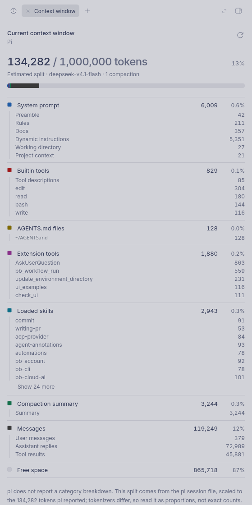

# bb-plugin-context-window

See how a thread's context window is used, without leaving the thread.



*The screenshot shortens the home directory path.*

A meter in each thread header shows the percentage used. Click it to open a
panel with the total, a stacked bar over the whole window, and every category
with its tokens, share, and sub-entries.

## Provider support

Only pi has a live test, on BB 0.46.1.

| Provider | Data from BB 0.46.1 | What the plugin shows | Tested |
| --- | --- | --- | --- |
| pi | Used and window | Estimated split from the pi session file | Yes |
| Claude Code | Category snapshot | The provider's split | No |
| ACP (Cursor) | Used and window | Total only | No |
| Codex | Used and window | Total only | No |

The snapshot path does not depend on the provider. If a provider reports a
category snapshot, the plugin shows it.

## Install

BB 0.46 or newer is required.

```
bb plugin install git:https://github.com/Fahridanaa/bb-plugin-context-window
```

From a clone:

```
npm install
npm run build
bb plugin install . --yes
```

## What it shows

- Used and total tokens, percent used, and free space.
- A stacked bar over the whole context window. Free space is the track.
- Categories with tokens and share: system prompt, builtin tools, AGENTS.md
  files, extension tools, loaded skills, compaction summary, and messages.
- Sub-entries where the data exists: system prompt sections, each tool schema,
  each loaded skill, and message groups.
- An **Estimated split** label when the split is derived. The panel says what
  the estimate is based on.

The meter opens the Context window panel in the thread's right panel. It shows
a ring and the percentage in the header, and the percentage alone on compact
viewports.

## Where the numbers come from

| Source | Meaning |
| --- | --- |
| `provider` | The agent reported a context snapshot. The panel shows the provider's categories. |
| `estimated` | Pi reports only `usedTokens`. The plugin parses the pi session file for this thread (system prompt sections, tool schemas, AGENTS.md files, skills, compaction summary, and messages still in context), then scales those proportions to the reported total. Counts are estimates; proportions are useful. |
| `none` | Only the used/window totals are known. The panel shows those and says a breakdown is not available. |

The panel refreshes on thread events (throttled to one fetch every two seconds
while a turn streams) and reconciles after a realtime reconnect.

When a thread runs on another machine, the pi session file is not on the BB
server host. The report says so instead of inventing a split.

## CLI

```
bb context-window show            # current thread (BB_THREAD_ID)
bb context-window show <id>       # another thread
bb context-window show <id> --json
```

The JSON report contains `source`, `usedTokens`, `contextWindowTokens`,
`categories`, `compactions`, and `detail`.

## Development

```
npm test                          # breakdown math and pi session parsing
npm run typecheck
npm run build
bb plugin install . --yes
```

The frontend uses host components and CSS variables only. Do not hardcode
colors. `dist/` is committed so a git install needs no build step.

## License

MIT
